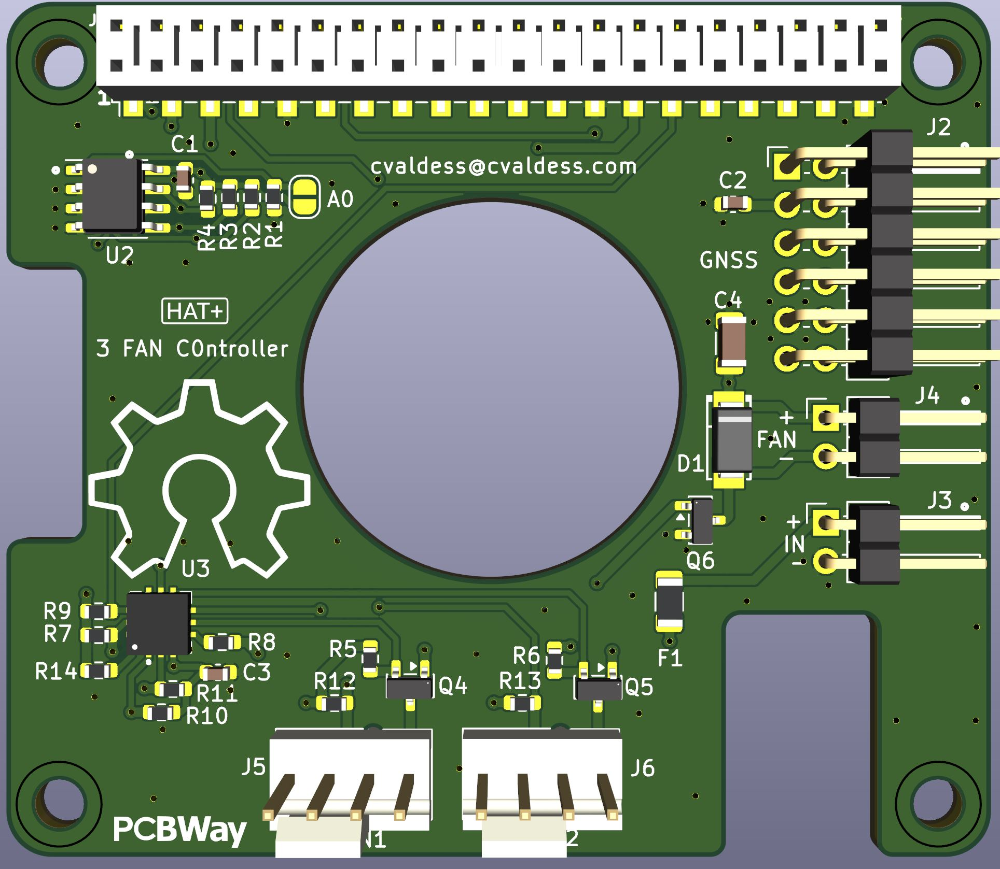

# Rpi3FanHatPlus

Raspberry Pi 5 **HAT+** that drives the three fans of a case with a Microchip **EMC2303**
fan controller and breaks out the Pi's UART and a PPS input for a **GNSS module** (J2).



> **Status:** revision 1, not yet manufactured or tested.

<a href="https://www.pcbway.com/project/shareproject/Rpi3FanHatPlus_d9ef2f33.html"></a>

## Features

- **EMC2303** I²C fan controller on the Pi's I²C1 bus (address `0x2E`, `ALERT` on GPIO5).
- **Fan 1 / Fan 2 (J5, J6):** standard 4-pin PWM fans with tachometer, e.g. Noctua NF-A4x10 PWM (12 V).
- **Fan 3 (J4):** small 2-wire 12 V fan (up to 100 mA) that cools the GNSS module, switched on
  the low side by an AO3400A MOSFET with an SS14 flyback diode.
- **GNSS connector (J2):** connects a GNSS module (a Unicore UM982 in this build) to the
  Raspberry Pi: UART0 (GPIO14/15), PPS on GPIO18, 5 V and GND.
- **12 V input (J3)** for the fans, protected by a 0.5 A resettable fuse.
- HAT+ ID EEPROM (AT24CS64) as required by the HAT+ specification.
- 4-layer board, 65 × 56.5 mm HAT+ outline, M3 mounting holes. Designed to sit on top of a PoE HAT.

## Connectors

| Ref | Function | Pinout |
|-----|----------|--------|
| J1 | Raspberry Pi 40-pin GPIO (Samtec HLE-120-02-F-DV-BE-A, bottom-entry SMT socket) | Standard Raspberry Pi header |
| J2 | **GNSS module to Raspberry Pi** (2×6, 2.54 mm, right angle) | 1: PPS → GPIO18 · 3: +5 V · 5: GPIO14 TXD (Pi → GNSS RX) · 7: GPIO15 RXD (GNSS TX → Pi) · 9: GND · others not connected |
| J3 | 12 V input (1×2, 2.54 mm) | 1: +12 V · 2: GND — **not keyed, check polarity** |
| J4 | Fan 3, 2-wire (1×2, 2.54 mm) | 1: +12 V · 2: Fan − (switched) |
| J5, J6 | Fan 1, Fan 2, 4-pin PWM (Molex 47053) | 1: GND · 2: +12 V · 3: Tach · 4: PWM |

GNSS signals on J2 are 3.3 V logic: the module's UART and PPS must not exceed 3.3 V.

## Raspberry Pi resources

| Signal | GPIO | Notes |
|--------|------|-------|
| I²C SDA / SCL | GPIO2 / GPIO3 | EMC2303 at `0x2E` |
| Fan controller ALERT | GPIO5 | Active low, 4.7 kΩ pull-up |
| UART TXD / RXD | GPIO14 / GPIO15 | GNSS module (J2) |
| GNSS PPS | GPIO18 | |
| HAT+ ID EEPROM | GPIO0 / GPIO1 | |

Example `config.txt` lines:

```text
dtparam=i2c_arm=on
enable_uart=1
dtoverlay=pps-gpio,gpiopin=18
```

### Fan controller notes

- PWM1/PWM2 reach the 4-pin fans through non-inverting 2N7002 stages: the EMC2303's default
  PWM polarity and open-drain output are correct.
- The fans stop at 0 % duty. At power-up the EMC2303 watchdog drives all fans to full speed
  after 4 s until the host writes a fan setting.
- Fan 3 has no tachometer: run it in direct-drive mode (no RPM control loop).

## Manufacturing

The [`HATPlus/fab/`](HATPlus/fab/) folder contains:

- `Rpi3FanHatPlus-gerbers.zip`: Gerber (4 copper layers, masks, paste, silkscreen, outline) and Excellon drill files.
- `HAT+-BOM-PCBWay.csv`: bill of materials with manufacturer part numbers and LCSC codes.
- `HAT+-CPL-PCBWay.csv`: component placement file, in millimetres, top side only.

The files are prepared for PCB fabrication and assembly (PCBA) at
[PCBWay](https://www.pcbway.com/). Board: 4 layers, 1.6 mm, ENIG recommended,
minimum track/space 0.15 mm, minimum drill 0.4 mm.

## Design files and tools

[KiCad 10](https://www.kicad.org/) project in [`HATPlus/`](HATPlus/) (`HAT+.kicad_pro`); project
footprint libraries in `HATPlus/libs/` and `libs/`.

The schematic review, design changes, footprints and fabrication outputs were done with
[Konnect](https://github.com/Orchis-ai-LLC/Konnect-EDA), an AI-assisted PCB design tool for
KiCad 10, driven by Anthropic's Claude through [Claude Code](https://claude.com/claude-code).

## Credits

Based on the [Raspberry Pi HAT+ KiCad template](https://github.com/MisterHW/RPi5-HATplus)
by Helge Wurst (CERN-OHL-S v2).

## License

Copyright © 2024 Helge Wurst (HAT+ template), © 2026 CValdesS.

This source describes Open Hardware and is licensed under the CERN-OHL-S v2
([LICENSE](LICENSE)). You may redistribute and modify this source and make products using it
under the terms of the CERN-OHL-S v2. This source is distributed WITHOUT ANY EXPRESS OR IMPLIED
WARRANTY, INCLUDING OF MERCHANTABILITY, SATISFACTORY QUALITY AND FITNESS FOR A PARTICULAR
PURPOSE. Please see the CERN-OHL-S v2 for applicable conditions.

Source location: https://github.com/cvaldess/Rpi3FanHatPlus
